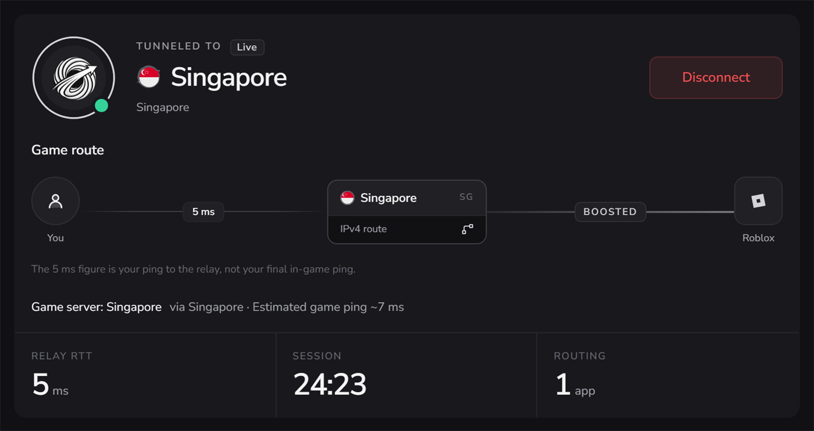
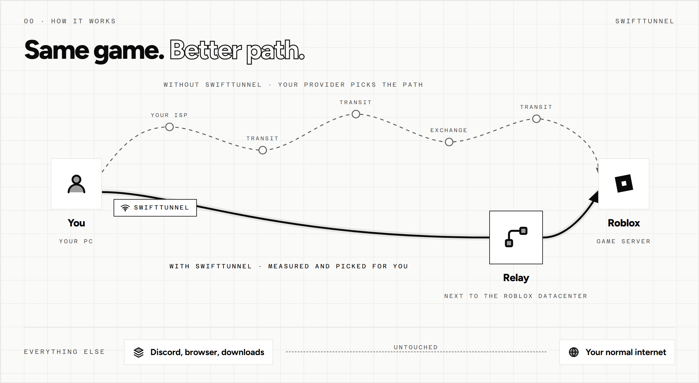
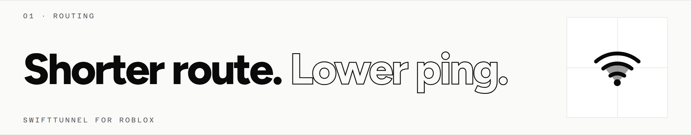
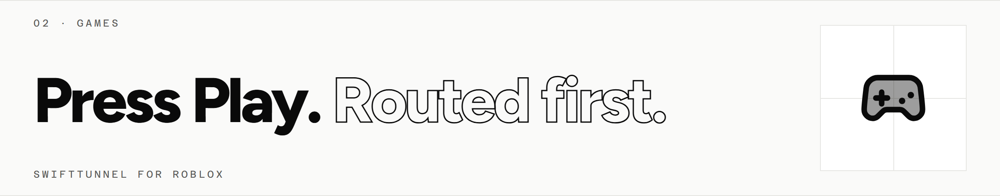

# SwiftTunnel: Low-Latency Roblox Network Optimizer for Windows 11

### 💻 PowerShell Installer

   

---

SwiftTunnel is a free Windows desktop application that reduces Roblox ping and lag by routing game traffic through a relay positioned near the target Roblox datacenter, leaving all other system traffic on the default connection. Beyond relay-based routing with automatic or manual server selection and split tunneling, the app bundles per-game FPS and graphics profiles, a FastFlags editor, a live in-game overlay, and reversible Windows tuning presets. It runs natively on Windows 10 and 11 across x64 and ARM64, supports launchers such as Bloxstrap, Fishstrap, and Voidstrap, and confines its changes to Roblox's own settings files without injecting into the game client.

## ✅ Requirements

- Windows 10 or Windows 11
- PowerShell 5.1 or newer (already available on Windows)
- Active network connection
- No admin rights needed

## Features

- **Automatic relay selection.** SwiftTunnel identifies the Roblox server you have joined and routes your traffic through the relay with the best path to that datacenter, without manual configuration.
- **Manual relay override.** You can pin a specific relay at any time; SwiftTunnel respects that choice and keeps it across sessions.
- **Pre-connection ping estimates.** Each relay location displays an estimated ping before you connect, and the active relay is always visible in the interface.
- **Split tunneling.** Only Roblox traffic is routed through the relay. Other applications — voice chat, browsers, downloads, streaming — continue on your normal connection.
- **Restricted-network support.** Where Roblox is blocked on a network or in a region, SwiftTunnel can carry Roblox traffic through a relay so sign-in and gameplay remain available.
- **Game library.** Your Roblox games are organized in one place with favourites, shortcuts, rejoin, and a recent-games list of the last four titles played.
- **One-press launch.** Pressing Play connects the appropriate relay first, then launches Roblox directly into the selected game.
- **Per-game location preferences.** Assign a preferred relay location to each game, or select a fastest-join option to let SwiftTunnel choose.
- **Server matchmaker.** Restrict matchmaking to specific Roblox datacenter cities, then select servers by lowest ping or fewest players. Optionally filter for servers with free slots so friends can join, and browse public servers by location before joining.
- **FPS and graphics controls.** Unlock the frame rate with a user-defined cap, and adjust graphics quality, window size, and fullscreen behavior.
- **Per-game profiles.** Each game can carry its own FPS cap and graphics settings; your default configuration is restored when Roblox closes.
- **FastFlags editor.** Toggle supported Roblox flags through simplified switches and choices rather than raw JSON, with an advanced editor for adding flags by name or editing the JSON directly.
- **NVIDIA profile integration.** Applies a tuned profile to the Roblox player on compatible NVIDIA GPUs.
- **Ultraboost mode.** Prioritizes maximum frame rate at the lowest visual detail for competitive scenarios.
- **Settings import and reset.** Import supported settings from other launchers, or restore Roblox to defaults in a single action.
- **In-game overlay.** Displays live FPS, game ping, active relay, play time, Roblox CPU and RAM usage, GPU metrics, temperatures, upload and download rates, and the current time.
- **Overlay customization.** Choose between straight or layered layouts, three sizes, six accent colors, and nine screen positions. Toggle visibility at any time with a keyboard shortcut; the overlay hides automatically when focus moves to another application.
- **Game Boost presets.** Four tuning levels — Beginner, Intermediate, Advanced, and Expert — apply graduated Windows optimizations.
- **Speed Up tweak categories.** Individual adjustments across System, Performance, System Response, Network, Input, File System, Memory and Cache, Windows Services, Startup and Shutdown, and Privacy.
- **Full reversibility.** Every tweak can be undone individually or all at once; uninstalling restores Roblox and Windows to their prior state.

## How it works

SwiftTunnel operates on a split-tunnel architecture. A Windows Packet Filter driver intercepts traffic at the network layer and classifies packets by destination, routing only Roblox game and matchmaking traffic through the SwiftTunnel UDP relay while all other applications continue on the system's default route. The relay sits in the same datacenter region as the target Roblox server, so the tunneled path avoids congested or circuitous transit segments that ISP routing would otherwise impose.

Relay selection is dynamic. On launch, the engine resolves the Roblox server the client is joining, measures candidate relays against it, and connects the lowest-latency route. A manual override pins a specific relay across sessions. Pre-connection ping estimates for every location are surfaced in the interface, so the expected result is visible before the tunnel is engaged.

Game launching is orchestrated by the app rather than the Roblox client. Selecting a game triggers a sequence: optional matchmaker server selection within permitted datacenter cities, relay connection to that server, then handoff to the Roblox player. Per-game relay preferences persist, and a location-agnostic mode defers to whichever relay yields the fastest join.

Roblox-side configuration is applied through the game's own settings files, the same surface written by the in-game menu and third-party launchers. Per-game profiles set FPS caps, graphics quality, and window behavior for the duration of a session and restore prior values on exit. The FastFlags editor writes supported flags through switches and structured overrides, with an advanced mode that accepts flag names or direct JSON edits, and an import path pulls compatible settings from existing launchers.

Instrumentation runs alongside the tunnel. An in-game overlay reads live telemetry including frame rate, game ping, active relay, session duration, process CPU and memory, GPU metrics, temperatures, and throughput. It is toggleable by hotkey and suspends rendering when focus leaves Roblox.

Windows-level tuning is exposed as discrete, named tweaks grouped by category, applied through reversible system configuration changes. Each modification records its prior state, enabling individual or bulk rollback, and uninstallation restores Roblox and system settings to their original values.

## Compatibility

SwiftTunnel targets **Windows 10 and Windows 11** on both **x64** and **ARM64** PCs. It is a native Windows application and does not run on macOS, Linux, or mobile platforms.

- **Operating system.** Windows 10 (version 1809 or later) and Windows 11 are supported. Older builds of Windows 10 may lack the network filtering components the tunnel relies on.
- **Architecture.** Separate builds ship for x64 and ARM64 processors. The MSI packages are available in both variants for managed deployments.
- **Roblox client.** Works with the standard Windows Roblox player and with Roblox VNG. No specific Roblox version is pinned; the app reads Roblox's own settings files and configures routing around the live client.
- **Third-party launchers.** Compatible with Bloxstrap, Fishstrap, and Voidstrap alongside the default launcher. Existing supported settings can be imported from these launchers.
- **Split tunneling.** Requires the Windows Packet Filter driver, which is installed with the app. This is what keeps Roblox traffic on the relay while every other application stays on the normal connection.
- **Administrator rights.** Required at runtime for the network driver and for the Windows tuning features. The core tunnel and optimization modules will not activate without elevation.
- **NVIDIA integration.** The NVIDIA profile option for the Roblox player applies only on compatible NVIDIA GPUs. It is skipped on systems without a supported GPU.
- **Elevated and protected environments.** Where group policy or endpoint protection blocks driver installation, the routing features may be unavailable. The Roblox settings and optimizer tools remain usable independently.
- **Network requirements.** An active internet connection and outbound access to SwiftTunnel relays are required. Split tunneling does not alter DNS or route non-Roblox traffic.

Compatibility is validated against current stable Windows releases and the live Roblox client during each release cycle.

## 📸 Screenshot

## Security

- **Signed updates.** The updater only installs releases whose signatures validate; unsigned or tampered packages are rejected before anything is written to disk.
- **Verifiable builds.** Every installer and update artifact is produced by the project's automated release workflow and carries a build attestation, so any download can be independently verified against the published release before you run it.
- **Least-privilege networking.** Split tunneling is enforced at the driver level, so only Roblox traffic is routed through the relay. Browsers, chat clients, and other applications remain on the normal connection and are never captured.
- **No injection into Roblox.** SwiftTunnel does not hook, patch, or inject code into the Roblox process. It operates on the network path and on Roblox's own supported settings files, keeping the game binary untouched.
- **Reversible system changes.** Every optimization and Roblox settings modification is recorded and can be undone individually or in bulk, and uninstalling restores the prior configuration.
- **Local-first data handling.** Configuration, profiles, and settings live on the local machine; no gameplay data is collected for the tunnel's operation beyond what routing requires.
- **Open source and auditable.** The full source for the app, engine, and relay is public, allowing independent review of the network stack, update mechanism, and driver integration.
- **Coordinated disclosure.** Vulnerabilities are handled through the project's security policy, with reports triaged and fixes shipped through the signed update channel.

## FAQ

**Is SwiftTunnel safe?**

Yes. The source code is public, and every installer is produced by the project's GitHub release workflow and carries a verifiable build attestation (see Security). The updater only installs releases with a valid signature. Download only from official sources: this repository or the project's own website.

**Can using SwiftTunnel get my Roblox account banned?**

No. SwiftTunnel does not inject code into Roblox or modify the running game process. It changes the network route your Roblox traffic takes and edits Roblox's own settings files — the same files the in-game settings menu and launchers like Bloxstrap write. The FastFlags editor only permits flags that Roblox itself supports.

**Is SwiftTunnel a VPN?**

No. A VPN routes all of your traffic through a remote server. SwiftTunnel applies split tunneling so only Roblox traffic goes through the relay; everything else on your PC stays on your normal connection. It does not mask your IP from other websites.

**Will SwiftTunnel actually lower my ping?**

For most players, yes — but results depend on your internet provider's default routes to Roblox datacenters. SwiftTunnel matches you to a relay with the best route to the server you're playing on. You can preview estimated ping for every relay location before connecting.

**Does SwiftTunnel work alongside Bloxstrap, Fishstrap or Voidstrap?**

Yes. Continue using your preferred launcher. SwiftTunnel can import supported settings from it and does not require you to switch.

**Why does SwiftTunnel require administrator rights?**

Separating Roblox traffic from the rest of your connection requires a network driver, and the Windows optimization tweaks modify system settings. Both operations require elevated privileges.

**Does SwiftTunnel support ARM64 Windows PCs?**

Yes. SwiftTunnel runs on Windows 10 and 11 on both x64 and ARM64 hardware. An arm64 MSI package is available for managed installs.

**Can I undo the changes SwiftTunnel makes?**

Yes. Every Game Boost and Speed Up tweak can be reverted individually or all at once. Roblox settings can be reset to default in one press, and uninstalling restores Roblox to its original state.

**Does SwiftTunnel work if Roblox is blocked on my network or in my country?**

Yes. SwiftTunnel can carry Roblox traffic through a relay so you can still sign in and play when Roblox is blocked on your network or in your region.

**What is SwiftTunnel Lite?**

A smaller build compiled natively for Windows with no embedded browser engine. It provides the same relays and core Roblox networking features, available from the same official download sources.

**How does SwiftTunnel keep itself updated?**

The app updates itself automatically. You can choose the Stable channel for vetted releases or the Live channel for early builds. Updates are installed only after their signatures are verified.

## License

SwiftTunnel is distributed under the MIT License. The full license text is included in the `LICENSE` file at the root of this repository and governs all use, reproduction, modification, and redistribution of the source code, the compiled Windows application, and the bundled engine.

Under the terms of this license, you are free to use, copy, modify, merge, publish, distribute, sublicense, and sell copies of the software, provided that the copyright notice and permission notice are preserved in all copies or substantial portions of the software. The software is provided "as is," without warranty of any kind, express or implied, including but not limited to the warranties of merchantability, fitness for a particular purpose, and noninfringement. In no event shall the authors or copyright holders be liable for any claim, damages, or other liability arising from, out of, or in connection with the software or its use.

This licensing model applies uniformly across the components of the project: the desktop application interface, the Rust-based engine responsible for tunneling, split tunneling, Roblox tooling, and system optimizations, as well as the SwiftTunnel Lite build. The Windows Packet Filter dependency used for split tunneling is provided by NT KERNEL under its own separate licensing terms, and the Tauri, React, and WiX components retain their respective upstream licenses. Third-party notices are aggregated in the repository for reference.

Because the source is publicly available and permissively licensed, you may audit the code, build installers from source yourself, and verify that published release artifacts match the source tree. Attribution to the SwiftTunnel project is appreciated but not required beyond the standard preservation of the copyright and permission notices mandated by the MIT License.

If you redistribute a modified build, retain the original license file and clearly indicate any changes you have made. The project name and any associated branding remain the property of the SwiftTunnel maintainers and are not granted for use in a way that suggests endorsement of derivative works.